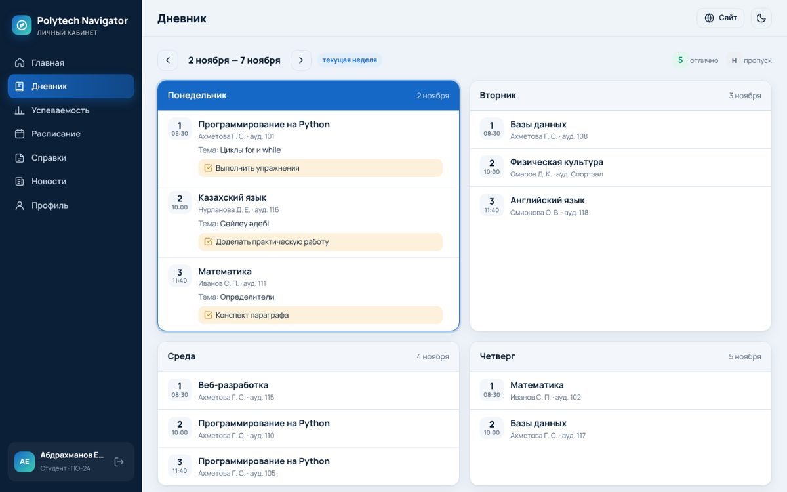
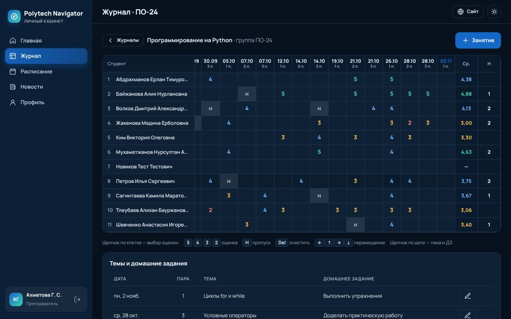
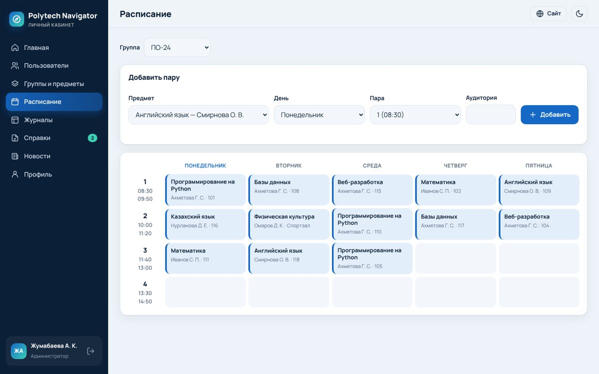

# Polytech Navigator — студенческий портал УКВПК

Сайт колледжа с **личным кабинетом** и **электронным дневником**: главная страница с новостями и расписанием звонков, а также кабинеты для студентов, преподавателей и учебной части.



## Возможности

**Студент**
- Главная: средний балл, посещаемость, пропуски, пары на сегодня (текущая пара подсвечивается), последние оценки, домашние задания, замечания и благодарности, новости.
- **Дневник** — неделя с понедельника по субботу: пары, аудитории, темы, домашние задания, оценки и комментарии преподавателя; можно листать недели.
- **Успеваемость** — все оценки по предметам, средний балл и пропуски, с фильтром по месяцам.
- **Расписание** группы и расписание звонков.
- **Справки** — заказ справки онлайн (с места учёбы, в военкомат, о стипендии и т. д.) и статус заявки.
- Новости, профиль (контакты, смена пароля).

**Преподаватель**
- **Журнал** по каждой группе и предмету: сетка «студенты × занятия», выставление оценок кликом или с клавиатуры (`5` `4` `3` `2`, `Н` — пропуск, `Del` — очистить, стрелки — перемещение), комментарии к оценкам, средний балл и пропуски по строке.
- Занятия: дата, номер пары, тема и домашнее задание (сразу видны студентам в дневнике).
- Карточка студента: успеваемость по всем предметам, замечания и благодарности.
- Своё расписание, пары на сегодня с быстрым переходом в журнал.

**Администратор (учебная часть)**
- Статистика по колледжу и успеваемость по группам.
- Пользователи: создание (пароль генерируется автоматически), редактирование, сброс пароля, удаление.
- Группы (курс, специальность, куратор), предметы, **нагрузка** (какой преподаватель ведёт какой предмет в группе).
- Составление расписания с проверкой накладок у группы и у преподавателя.
- Обработка заявок на справки, публикация новостей, доступ ко всем журналам.



## Запуск

Нужен только **Node.js 22.13+** — внешних зависимостей нет (база — встроенный `node:sqlite`).

```bash
npm start            # http://localhost:3000
```

При первом запуске база (`data/portal.db`) заполняется демо-данными: 3 группы, 7 преподавателей, 28 студентов, расписание и журнал с оценками с 1 сентября.

| Роль | Логин | Пароль |
|---|---|---|
| Студент (ПО-24) | `student` | `student123` |
| Преподаватель | `teacher` | `teacher123` |
| Администратор | `admin` | `admin123` |

Остальные демо-преподаватели — `t.ivanov`, `t.bekov` и др. (пароль `teacher123`), студенты — `st.po24.2`, `st.es25.1` и т. п. (пароль `student123`).

```bash
npm run seed         # пересоздать базу с демо-данными
npm test             # интеграционные тесты API
```

### Переменные окружения

| Переменная | По умолчанию | Назначение |
|---|---|---|
| `PORT` | `3000` | порт сервера |
| `HOST` | `0.0.0.0` | адрес |
| `DB_PATH` | `data/portal.db` | файл базы SQLite |
| `TZ` | `Asia/Almaty` | часовой пояс колледжа (какой день «сегодня») |
| `SEED` | — | `0` — не заполнять пустую базу демо-данными |
| `DEMO` | — | `0` — скрыть кнопки демо-входа на странице логина |
| `COOKIE_SECURE` | — | `1` — флаг `Secure` для cookie (при работе через HTTPS) |
| `TRUST_PROXY` | — | `1` — брать IP клиента из `X-Forwarded-For` (за обратным прокси, для защиты от перебора паролей) |

## Размещение в интернете (Render)

В репозитории есть `render.yaml`: на [render.com](https://render.com) выберите **New → Blueprint**, подключите этот репозиторий и ветку — сайт соберётся и получит адрес вида `https://….onrender.com`. Всё делается из браузера, в том числе с телефона.
Бесплатный тариф хранит базу только до перезапуска: после «засыпания» сервиса демо-данные создаются заново. Для настоящей работы нужен тариф с постоянным диском (см. комментарии в `render.yaml`).

## Перед запуском в работу

1. Запустите с `SEED=0 DEMO=0` на чистой базе и создайте администратора:
   ```bash
   node --disable-warning=ExperimentalWarning -e "
   const {run}=require('./src/db');const {hashPassword}=require('./src/util');
   run('INSERT INTO users (login,pass_hash,role,full_name) VALUES (?,?,?,?)','admin',hashPassword('НАДЁЖНЫЙ-ПАРОЛЬ'),'admin','ФИО администратора')"
   ```
2. Дальше всё заводится в кабинете администратора: предметы → группы → пользователи → нагрузка → расписание.
3. Разместите сервер за обратным прокси (nginx/Caddy) с HTTPS и включите `COOKIE_SECURE=1`.
4. Регулярно делайте резервную копию файла `data/portal.db`.

## Устройство

```
server.js            HTTP-сервер: статика, API, заголовки безопасности
src/db.js            схема базы SQLite
src/api.js           все эндпоинты /api/* с проверкой ролей
src/auth.js          сессии (HttpOnly cookie), защита от перебора паролей
src/util.js          даты, валидация, хеширование паролей (scrypt)
src/seed.js          демо-данные
public/index.html    главная страница сайта
public/cabinet.html  личный кабинет (SPA: public/js/cabinet.js)
public/css/style.css общий стиль, светлая и тёмная темы
test/api.test.js     тесты API
```

**Безопасность:** пароли хранятся в виде хешей scrypt; сессионная cookie `HttpOnly` + `SameSite=Strict`; изменяющие запросы принимаются только как JSON и только со своего Origin; все права проверяются на сервере (преподаватель видит только журналы своих групп); CSP запрещает сторонние скрипты; все данные в интерфейсе экранируются.


